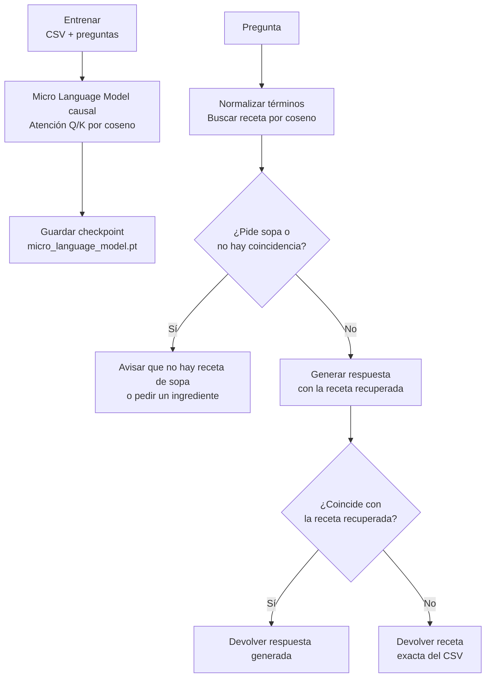

# Micro Language Model · Modelo de lenguaje pequeño

**Proyecto educativo de un modelo de lenguaje pequeño, entrenado desde cero con recetas.** Está pensado para practicar tokenización, generación autoregresiva, atención causal y recuperación por similitud de coseno. No es un asistente general ni un recetario validado.

**Educational tiny language model trained from scratch on a recipe dataset.** It demonstrates word-level tokenization, autoregressive generation, causal attention, and cosine-similarity retrieval. It is not a general assistant or a validated cookbook.

## Qué incluye / What this project includes

- Un GPT causal pequeño implementado en PyTorch: 2 bloques, 4 cabezas de atención, dimensión 64 y contexto máximo de 192 tokens.
- Atención propia: normaliza Q y K y calcula sus puntajes con similitud de coseno; una máscara causal impide mirar tokens futuros.
- Recuperación TF-IDF por coseno sobre los ingredientes del CSV, usada como contexto para responder preguntas.
- CLI para entrenar, preguntar una vez o conversar en modo interactivo.
- Dataset de entrenamiento incluido: 1.000 filas en `data/generated_recipe_dataset.csv`.

## Inicio rápido / Quick start

Requiere Python 3.14. En macOS y Linux, ejecuta desde la carpeta del proyecto:

```bash
python3.14 -m venv .venv
.venv/bin/python -m pip install -r requirements.txt
.venv/bin/python micro_language_model.py train
.venv/bin/python micro_language_model.py ask "I have carrots and peas, what can I make?"
```

En Windows PowerShell (los comandos son equivalentes; esa plataforma no se verificó en el equipo de desarrollo):

```powershell
py -3.14 -m venv .venv
.venv\Scripts\python.exe -m pip install -r requirements.txt
.venv\Scripts\python.exe micro_language_model.py train
.venv\Scripts\python.exe micro_language_model.py ask "I have carrots and peas, what can I make?"
```

Usa el intérprete dentro de `.venv` para que `pip` instale PyTorch en ese entorno y no en el Python administrado por Homebrew. El entrenamiento tarda alrededor de un minuto en el equipo de desarrollo, pero el tiempo depende del hardware. Crea `micro_language_model.pt` localmente; ese artefacto se ignora en Git y se puede regenerar con `train`.

### Más formas de usarlo / More ways to use it

```bash
# Pregunta sin ingredientes conocidos en el CSV
.venv/bin/python micro_language_model.py ask "whats the recipe for soup"

# Consulta natural con plurales o alias en español
.venv/bin/python micro_language_model.py ask "Tengo zanahorias y guisantes, ¿qué puedo preparar?"

# Modo interactivo; escribe /salir para terminar
.venv/bin/python micro_language_model.py ask

# Opciones de entrenamiento y consulta
.venv/bin/python micro_language_model.py train --help
.venv/bin/python micro_language_model.py ask --help
```

Las respuestas de recetas están en inglés, porque el dataset está en inglés. El prototipo reconoce algunos nombres de ingredientes, plurales y alias en español. Si pides sopa, indica que el dataset no contiene recetas de sopa; si no encuentra un ingrediente conocido, te pide uno.

## Cómo funciona / How it works



Micro Language Model usa un Transformer causal autoregresivo, no una llamada a una API. Como la generación puede cambiar detalles, el CLI solo la acepta si su secuencia de palabras coincide con la receta recuperada; en otro caso devuelve la fila original del CSV. Consulta la [guía de aprendizaje](docs/LEARNING_GUIDE.md) y la [tarjeta del modelo](docs/MODEL_CARD.md) para ver los detalles y límites.

## Estructura del repositorio / Repository layout

```text
micro-language-model/
├── data/generated_recipe_dataset.csv  # Datos usados para entrenar y recuperar
├── docs/
│   ├── DATASET.md                     # Esquema, estadísticas y procedencia
│   ├── LEARNING_GUIDE.md              # Recorrido técnico paso a paso
│   └── MODEL_CARD.md                  # Uso previsto y limitaciones
├── micro_language_model.py              # Entrenamiento, modelo y CLI
├── requirements.txt                   # Dependencias fijadas
└── CONTRIBUTING.md                    # Guía y ejercicios de práctica
```

## Contenido educativo / Learning path

1. Sigue `read_dataset`, `make_training_sequences` y `train` en `micro_language_model.py`.
2. Estudia `CosineSelfAttention`, `TransformerBlock` y `MicroGPT`.
3. Compara `cosine_similarity` (búsqueda en recetas) con Q/K por coseno (atención interna).
4. Usa los ejercicios sugeridos en [CONTRIBUTING.md](CONTRIBUTING.md) para extender el prototipo.

## Datos y licencia / Data and licensing

El dataset proviene del archivo `SLM Dataset.zip` proporcionado para este proyecto. El ZIP solo contenía el CSV, sin autor, fuente ni licencia. El proyecto lo publica para el uso educativo solicitado; su procedencia y derechos de redistribución no están verificados. Consulta [docs/DATASET.md](docs/DATASET.md) antes de reutilizarlo fuera de este contexto. No se asigna una licencia de software o datos en este repositorio.

---

## English summary

Clone the repository, create a Python 3.14 virtual environment, install `requirements.txt`, then run `micro_language_model.py train` before asking questions. The CSV is included; generated weights are intentionally not versioned. This is a domain-limited learning prototype: it combines a tiny causal Transformer with cosine-based recipe retrieval and falls back to the retrieved CSV row when generation changes its wording. See the linked docs for setup, data provenance, architecture, and limitations.
